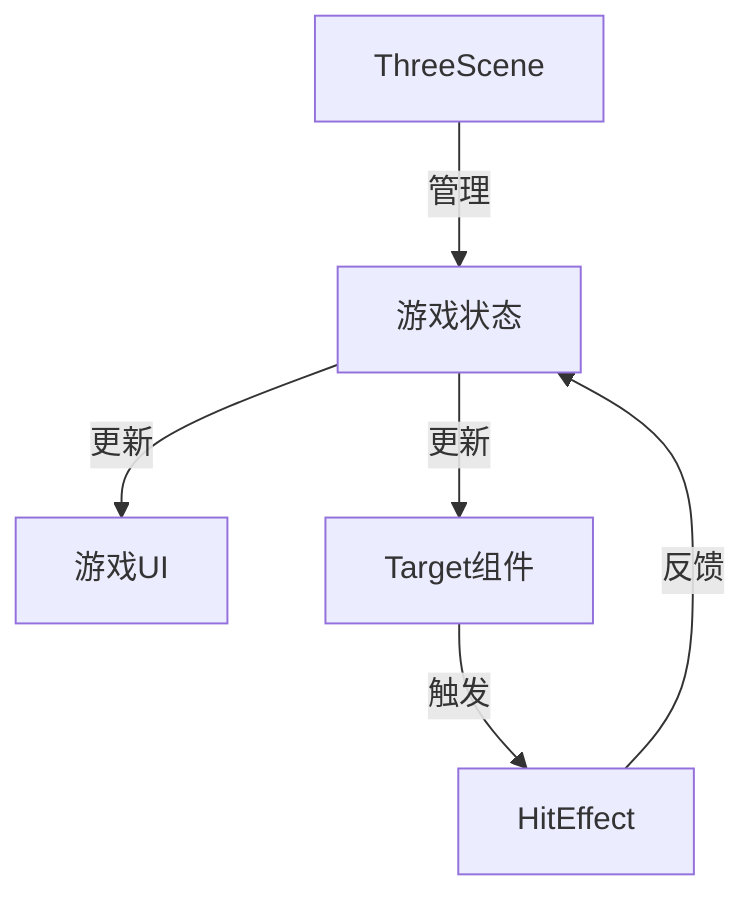

# Cool ThreeJS API 文档

## 组件接口

### ThreeScene 组件

主游戏场景组件，负责：

- 管理游戏状态
- 渲染 3D 场景
- 处理用户交互

**Props**: 无

**State**:

- `score`: 当前分数
- `timeLeft`: 剩余时间
- `gameState`: 游戏状态(notStarted/playing/gameOver)
- `difficulty`: 游戏难度(1-3)

### Target 组件

3D 目标组件，表示可点击的目标立方体

**Props**:

- `position`: 初始位置 [x,y,z]
- `color`: 目标颜色
- `index`: 目标索引
- `count`: 目标总数
- `onHit`: 点击回调函数
- `difficulty`: 当前难度
- `isGameActive`: 游戏是否进行中

**方法**:

- `handleClick()`: 处理点击事件

### HitEffect 组件

击中特效组件，显示粒子效果

**Props**:

- `position`: 特效位置 [x,y,z]
- `color`: 粒子颜色

## 数据流

## 关键函数 API

### handleTargetHit(points: number)

处理目标被击中事件

**参数**:

- points: 获得的分数

**返回值**: 无

### startGame()

初始化并开始游戏

**参数**: 无  
**返回值**: 无

## 事件系统

| 事件      | 触发条件   | 参数     |
| --------- | ---------- | -------- |
| targetHit | 目标被击中 | 得分点数 |
| gameStart | 游戏开始   | 无       |
| gameOver  | 游戏结束   | 最终分数 |
